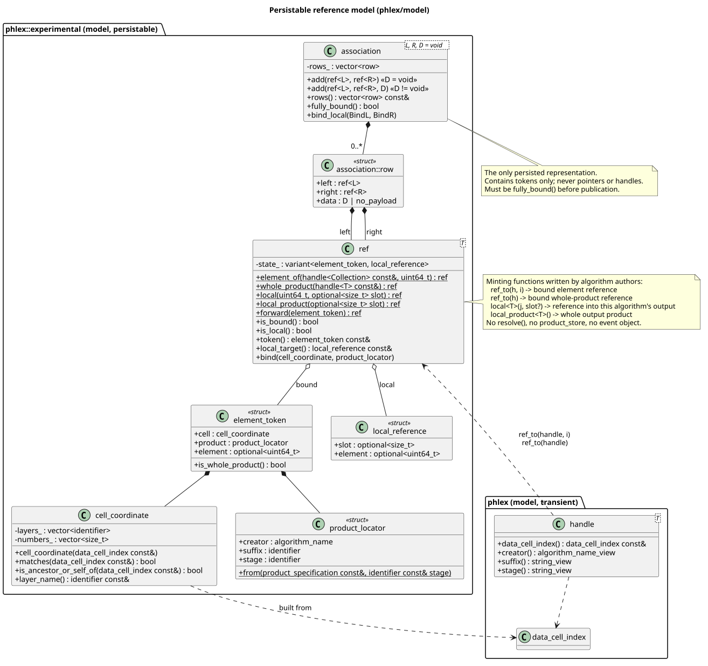
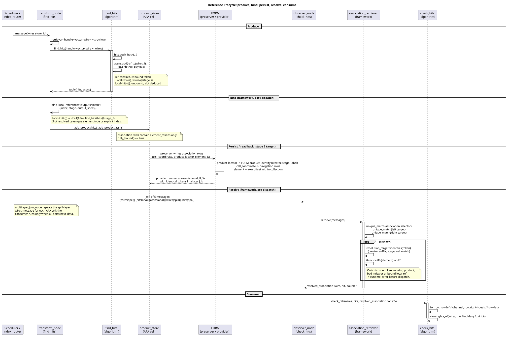
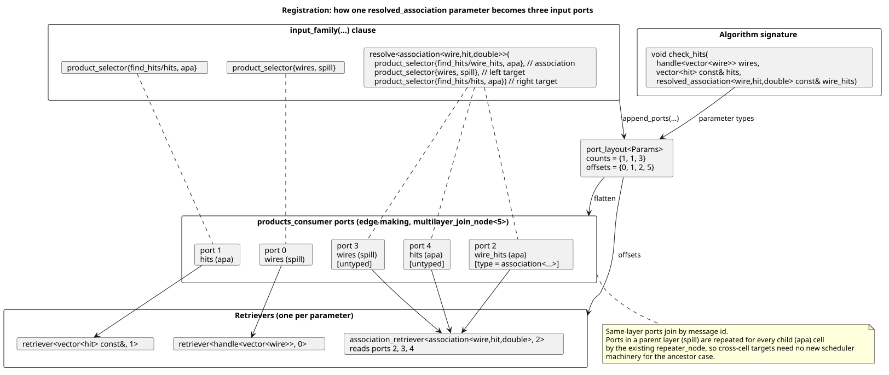
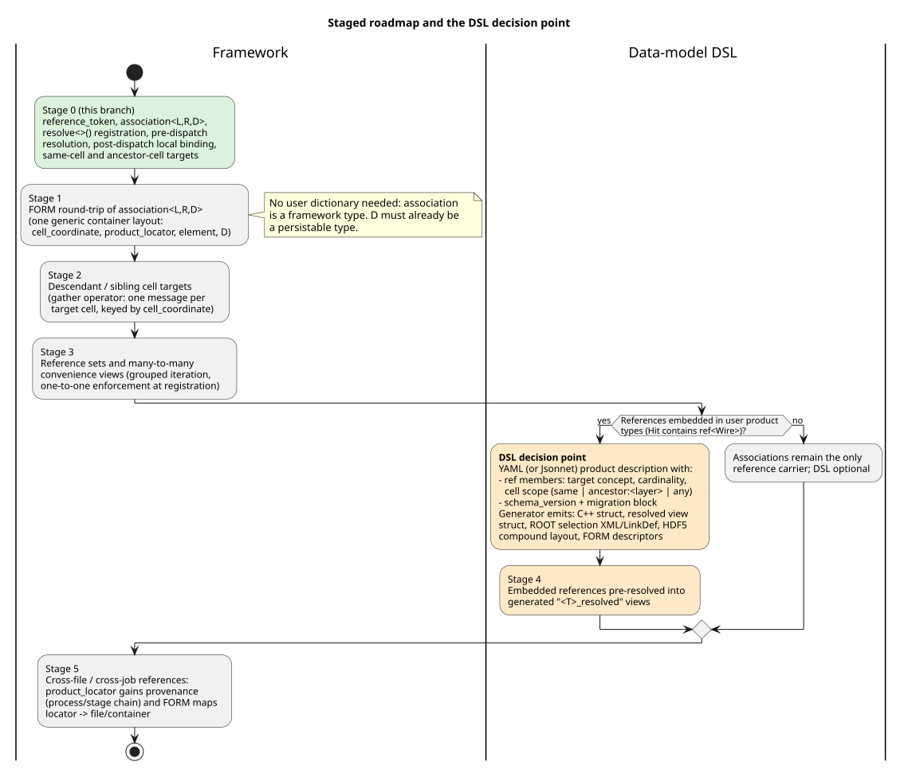

# Framework-Resolved Persistent References (Option C): Design and Prototype

Status: design analysis and working prototype, non-normative. Prepared 2026-10-30 in response to [the 2026-09-30 prompt](persistent-references-explorations-2026-09-30-prompt.md), as a *de novo* treatment of Option C from the [Phlex–art comparison report](phlex-art-comparison-report.md). Earlier documents under `docs/dev/persistent-references` were deliberately not consulted.

Prototype: branch `persistent-references-option-c` in `../phlex` (uncommitted working tree at the time of writing). Every code reference of the form `file:line` below points at that tree.

Status of the branch, by layer:

- **Model layer** (`phlex/model/reference_token.{hpp,cpp}`, `phlex/model/association.hpp`, and the association concept in `phlex/model/type_id.hpp`): *candidate implementation*. Covered by model and integration tests and shaped directly by decisions D1, D3, D4 of the README ledger. D16 is implemented and verified in the uncommitted branch; that removes the association-type matching blocker, but does not establish persistence readiness or team acceptance of the model API.
- **Core layer** (`phlex/core/reference_resolution.hpp`, `resolved_association.hpp`, `bind_local_references.*`, and the edits to `input_arguments.hpp`, `registration_api.hpp`, and the three node templates): *design validation*. It demonstrates that pre-dispatch resolution, ancestor-cell targets, and post-dispatch binding are expressible with the existing retriever, port, and join machinery and need no architectural change. It is not the proposed implementation: the resolved view's representation (two hash maps per invocation) is unmeasured; three-ports-per-association reuses edge making rather than introducing a port kind that `products_consumer` understands; the run-time port-count check in `registration_api` replaced a compile-time assertion; fold/unfold and transform/predicate consumers were stopped at, not designed for.

## 1. Summary

Option C ("opaque token resolved by the framework before algorithm dispatch") is viable and, with two additions, addresses the two gaps the art report identified in it: algorithms that *emit* references and algorithms that *forward* incoming references. Of the prompt's requirements, same-cell and ancestor-cell references, all three reference kinds, payloads, and forwarding are implemented; descendant/sibling cells, persistence, and selective (per-side) resolution are staged (Section 8). The two additions are:

1. A persistable `ref<T>` value type that algorithm code can place in an `association<L, R, D>` output product. It is minted only from a `handle<T>` the algorithm already received (`ref_to(handle, index)`), or as a *local* reference to the algorithm's own output (`local<T>(index)`), which the framework binds after the algorithm returns. Algorithm code never resolves anything and never sees a product store, an event object, or a minter object.
2. A registration clause, `resolve<association<L, R, D>>(assoc_selector, left_target, right_target)`, that declares which association an algorithm consumes and which products its tokens may point into (the *target scope*). The framework turns this into three input ports of the node, so the existing edge-making and multi-layer join machinery guarantees that the association and both targets are present before dispatch. Cross-cell targets in an *ancestor* layer work today through the existing `repeater_node`; descendant and sibling targets are a staged objective (Section 8).

The algorithm author's view is reduced to three things: `handle<T>` inputs, `ref_to`/`local` in producers, and `resolved_association<L, R, D> const&` in consumers.

The prototype implements the runtime path end to end in the framework (model + core), with tests covering token semantics, resolution error paths, same-cell and ancestor-cell graph execution, and rejection of an association-type mismatch during graph finalization. After D16, all 137 registered CTest tests pass; the new Catch2 cases extend existing test executables. The last coverage measurement was 81.7 % before D16; coverage has not been remeasured for the D16 changes.

An independent review of this design against the 2026-09-17 exploration is in [persistent-references-comparison-2026-10-30.md](persistent-references-comparison-2026-10-30.md); its findings are reflected in Section 10 and in the README decision ledger.

The data-model DSL decision is **not** forced by this stage. References embedded as data members of user product types require an explicit traversal, resolved-view and schema-evolution strategy; that is the later decision point for generated descriptions versus traits or handwritten adapters, not proof that a custom DSL is mandatory (Section 9).

## 2. Scope, inputs, and method

Inputs read for this analysis:

- `phlex-art-comparison-report.md` (Option C definition and trade-offs).
- Current Phlex `main` (`ce771e1d`): `phlex/model/*`, `phlex/core/{registration_api,input_arguments,transform_node,observer_node,predicate_node,multilayer_join_node,product_selector,message}.hpp`, `form/{core,persistence}`.
- art suite: `canvas` (`Ptr.h`, `RefCore.h`, `Assns.h`, `AssnsIter.h`, `FindMany.h.in`, `FindOne.h.in`, `detail/IPRHelper.h`, `ProductID.*`, `canonicalProductName.*`, `EDProductGetter.h`), `art` (`Principal.cc`, `Group.cc`, `ProductRetriever.*`, `PtrMaker.h`, `ConsumesInfo.*`), `art-root-io` (`RootDelayedReader.cc`), `canvas-root-io` (`RefCoreStreamer.cc`, `AssnsStreamer.h`, `ProductIDStreamer.cc`), `gallery` (`BranchData.*`, `DataGetterHelper.cc`, `FindMaker.h`).
- A refreshed survey of schema/IDL tooling (PODIO/EDM4hep, Protobuf, FlatBuffers, Cap'n Proto, Thrift, Avro, Arrow, ROOT, HDF5/HighFive/h5cpp, JSON Schema, LinkML, ASN.1, Bond, Smithy, CUE, Dhall, TypeSpec, OpenAPI) and HEP prior art (CMS, ATLAS, Gaudi, art, Belle II, ALICE O2, Awkward, Key4hep), all fetched from primary sources on 2026-10-30. Items that could not be verified are listed in Section 9.4.

The design was reviewed at four decision points with the design lead; the recorded choices are in Section 3.

## 3. Decisions taken

| # | Decision | Alternatives rejected | Why |
| --- | --- | --- | --- |
| D1 | Output references are minted from **handles** (`ref_to(handle, i)`) or as **local tokens** (`local<T>(j)`) bound by the framework after return. | (a) Pure `(i, j)` index pairs with registration naming each side; (b) a `PtrMaker`-like minter passed as a trailing argument. | (a) cannot forward an incoming `ref` unchanged and cannot name a cross-cell target; (b) reintroduces an ambient framework object into every producer, which is the art pattern Phlex is moving away from. Handles already carry cell index, creator, suffix and stage (`handle.hpp:88-98`), so a bound token costs nothing new. |
| D2 | Stage 0/1 supports references **only inside framework-owned `association<L, R, D>` products**, not as data members of user types. | Embedded `ref<Wire>` members from the start. | Embedded members require generated "resolved view" types and a dictionary per user type, which pulls the DSL decision into the first stage. Associations need exactly one generic persistence layout. |
| D3 | Consumers **declare the target scope at registration** (`resolve<>(assoc, left_target, right_target)`). | Deduce targets at run time from the tokens in the association. | Declared targets become graph edges: the scheduler can only run the consumer when the referenced products exist and are retained, and the multi-layer join handles ancestor cells with no new machinery. Run-time deduction cannot provide that guarantee and would require a global store registry. |
| D4 | Prototype lives as **library additions on a branch** (`phlex/model`, `phlex/core`, `test/`). | Self-contained directory under `test/`. | Shows the real integration cost: three node templates and the registration API had to learn that one parameter can occupy several ports. |

## 4. The algorithm author's view

### 4.1 Producing an association

```cpp
using wire_hits_t = phlex::experimental::association<wire, hit, double>;

std::tuple<std::vector<hit>, wire_hits_t> find_hits(phlex::handle<std::vector<wire>> wires)
{
  std::vector<hit> hits;
  wire_hits_t assns;
  for (std::size_t i = 0; i < wires->size(); ++i) {
    hits.push_back(make_hit((*wires)[i]));
    assns.add(ref_to(wires, i), local<hit>(hits.size() - 1), quality(hits.back()));
  }
  return {std::move(hits), std::move(assns)};
}
```

Registration is unchanged from today except that the wires parameter is a `handle<>` so that `ref_to` can mint a bound token:

```cpp
m.transform("find_hits", find_hits, concurrency::unlimited)
 .input_family(product_selector{.creator = "wires", .layer = "apa"})
 .output_product_suffixes("hits", "wire_hits");
```

`local<hit>(j)` names element `j` of "the output product whose element type is `hit`". When two outputs share an element type the slot is given explicitly (`local<hit>(j, 0)`). At binding the framework checks that the named output is a `std::vector<hit>` (or, for `local_product`, exactly the referenced type) and that `j` is in range; an ambiguous implicit slot, a type mismatch, or an out-of-range element is a run-time error before the products are published (`bind_local_references.hpp`, `validate_local_target`/`bind_one`). To forward an incoming reference unchanged: `ref<hit>::forward(row.right_token)`.

### 4.2 Consuming an association

```cpp
void check_hits(phlex::handle<std::vector<wire>> wires,
                std::vector<hit> const& hits,
                phlex::experimental::resolved_association<wire, hit, double> const& wire_hits)
{
  for (auto const& row : wire_hits) {        // row.left: wire const*, row.right: hit const*
    use(*row.left, *row.right, *row.data);   // row.data: double const*
  }
  auto hits_on_wire_3 = wire_hits.rights_of(wires, 3);   // vector<hit const*>; FindManyP::at idiom
}

m.observe("check_hits", check_hits, concurrency::serial)
 .input_family(
   product_selector{.creator = "wires", .layer = "spill"},
   product_selector{.creator = "find_hits", .layer = "apa", .suffix = "hits"},
   resolve<wire_hits_t>(
     product_selector{.creator = "find_hits", .layer = "apa", .suffix = "wire_hits"},
     product_selector{.creator = "wires", .layer = "spill"},                      // left target
     product_selector{.creator = "find_hits", .layer = "apa", .suffix = "hits"})); // right target
```

The algorithm receives pointers into the *actual* products (the test asserts `associated[0] == &hits[2 * i]`, `test/resolved_association_test.cpp:96`). Nothing in the algorithm body references a token, a store, or the framework.

### 4.3 What the author must know

- `handle<T>` is required for any input the algorithm wants to reference. `T const&` inputs cannot be referenced because the identity is not available (the handle's `data_cell_index`, creator, suffix and stage are what the token stores).
- Element references are to elements of `std::vector<T>`. Other contiguous containers are a small extension (`reference_resolution.hpp:225`), but the prototype fixes `std::vector` to keep the resolver's type recovery unambiguous.
- Associations must be returned from the same invocation that produces the referenced output, so that local tokens can be bound. An association that references an output of a *different* algorithm must use bound tokens from a handle.

## 5. Framework design

### 5.1 Model layer (persistable)



`phlex/model/reference_token.hpp`:

- `cell_coordinate` (`:34-55`): the persistable form of `data_cell_index`: layer names and cell numbers per level below `job`. `matches()` is exact; `is_ancestor_or_self_of()` supports scope checks. This is the "layer name + cell identifier" form requested in the prompt (Q8).
- `product_locator` (`:60-68`): `{creator, suffix, stage}`. The stage is included because the same creator/suffix can exist in several processing stages; it maps directly onto FORM's `product_identity{creator, stage, label}` (`form/core/product_identity.hpp:14-18`).
- `element_token` (`:74-82`): `{cell_coordinate, product_locator, optional<uint64_t> element}`. This is the report's triple `⟨cell_coord?, product_spec_id, element_index?⟩` with one deliberate change: `cell_coord` is **never** optional. "Same cell" is a property of the resolver's target, not of the token. An absent coordinate would make a token's meaning depend on where it is read, which is exactly the ambiguity that makes art's `ProductID` remapping across files necessary.
- `local_reference` (`:93-96`) and `ref<T>` (`:115-171`): `ref<T>` is a `std::variant<element_token, local_reference>`. It carries `T` only for compile-time checking of `association::add`; the persisted form is the token.
- `ref_to`, `local`, `local_product` (`:177-199`): the only minting functions.

`phlex/model/association.hpp`: `association<L, R, D = void>` stores `vector<row{ref<L>, ref<R>, D}>`. `D = void` collapses to an empty `no_payload` member (`[[no_unique_address]]`). `fully_bound()` and `bind_local()` support the post-dispatch binding step. `types.hpp` in the mock workflow now includes this header instead of its empty placeholder.

### 5.2 Core layer (transient)



`phlex/core/reference_resolution.hpp`:

- `resolve_selector<Assoc>` and `resolve<Assoc>(assoc, left, right)` (`:51-87`): the registration clause. `resolve<Assoc>()` stamps the association selector with a valid association `type_id`, containing ordered child IDs for its left type, right type, and payload type (`void` when absent). The association and children flags allow the existing comparison, hashing, and formatting implementations to operate without modification; exact RTTI remains recorded. Graph finalization now excludes producers with incompatible association concepts, and the suffix/type mismatch regression confirms rejection before any algorithm runs. Target selectors remain untyped because referenced element types do not uniquely determine their containing product types.
- `port_layout<Params>` (`:96-113`): compile-time map from algorithm parameters to ports. A `resolved_association` parameter occupies 3 ports; everything else 1.
- `association_retriever<Assoc, Offset>` (`:242-281`): the pre-dispatch resolver. For each row it checks that the token identifies the declared target (`resolution_target::identifies`, `:193-199`: creator, suffix, stage, and exact cell), then materializes `&vector<T>[element]` or `&T`. Every failure mode is a `std::runtime_error` *before* the algorithm runs, with the association selector, side, and token in the message.

`phlex/core/resolved_association.hpp`: the view handed to the algorithm. Rows hold `gsl::not_null` pointers plus both tokens; `rights_of`/`lefts_of` give art's `FindManyP::at` navigation through hash maps keyed by token.

`phlex/core/bind_local_references.hpp`: `bind_local_references<OutputTuple>(result, {index, stage, output_specs})` runs inside `transform_node` immediately after the algorithm returns (`transform_node.hpp:94-98`). Slot deduction is a `constexpr` search over the output tuple for a unique `vector<T>` or `T`.



Changes to existing files preserve the existing runtime interfaces except for the additional association concept; full-suite regression results are in Section 7:

- `input_arguments.hpp`: `retriever<T, Offset>` reads its own port from the message tuple; `form_input_arguments` builds one retriever per *parameter* at its port offset.
- `registration_api.hpp`: `input_family(...)` accepts `product_selector` or `resolve_selector<>` arguments (`is_input_spec`), flattens them to a `product_selectors` port list, validates the count at run time with a message naming the algorithm, and types only the single-product ports. Fold and unfold reject resolved associations with a `static_assert`; nothing in the prompt requires them there yet.
- `transform_node.hpp`, `observer_node.hpp`, `predicate_node.hpp`: distinguish `num_parameters` (algorithm arity) from `num_products` (port count, used for the join node and `receiver_for`).

### 5.3 Cross-cell resolution (OD-2)

Target selectors carry a layer. The existing `products_consumer` already computes per-port layers and `multilayer_join_node` inserts a `repeater_node` for ports whose layer differs (`multilayer_join_node.hpp:23-46,85`). Declaring `wires` in `spill` as the left target of an `apa`-layer association therefore makes the spill product arrive once per APA message with no new code; `test/resolved_association_test.cpp:145-188` exercises this with 2 spills × 3 APAs. The resolver's exact `cell_coordinate::matches` check still passes because the token was minted from the spill-cell handle and the repeated message carries the spill store.

What is *not* covered: a token into a **descendant** or **sibling** cell (track in spill → hit in APA 7). The join machinery has no "gather" primitive. Section 8 stages it.

## 6. Comparison with art, from the author's seat

| Concern | art | This design |
| --- | --- | --- |
| Identity of a reference | `ProductID` (CRC32 of canonical name) + `key`; transient `itemPtr_`, `EDProductGetter*` | `element_token{cell_coordinate, product_locator, element}`; no transient state in the token |
| Minting | `PtrMaker<T>{event}` predicts the `ProductID` of a not-yet-put product | `ref_to(handle, i)` for inputs; `local<T>(j)` bound by the framework for outputs |
| Who resolves | The user, lazily, on `Ptr::operator*` through `Group::resolveProductIfAvailable` | The framework, eagerly, before dispatch; failures are scheduling-time errors |
| Declaring reads | `consumes<T>(tag)` validated at retrieval | `resolve<>()` is a graph edge; the consumer cannot run without its targets |
| Navigation | `FindManyP<Hit> f(handle, evt, tag); f.at(i)` | `view.rights_of(handle, i)` on a pre-built view |
| Cross-level references | `Ptr` to a Run product from an Event resolves via the Run principal; `RangeSet` caveats | Ancestor-layer targets via repeater; descendant/sibling staged |
| Persistence | `Assns` transient↔persistent conversion in `AssnsStreamer`, `RefCoreStreamer` reattaches getters on read | Association rows are already the persisted form; nothing to reattach |

The notable cost relative to art is registration verbosity: three selectors per association input. The notable gain is that every misreference is caught before user code runs, with a message naming the algorithm, the association, the side, and the token.

## 7. Verification

| Test | What it covers | File |
| --- | --- | --- |
| `type_id` | Valid association concept, ordered left/right/payload child IDs, swapping endpoints with different concepts, payload differences, equality, ordering, hashing, formatting, qualifiers and lists of associations | `test/type_id_test.cpp` |
| `reference_token` | `cell_coordinate` construction/matching/ancestry, `product_locator`, bound/local/forwarded `ref`, hashing, `association` add/bind with and without payload | `test/reference_token_test.cpp` |
| `reference_resolution` | `resolve<>()` typing, `port_layout`, `populate_port_types`, `append_ports`, product retriever port selection and errors, cross-cell row resolution, every rejection path (wrong cell/stage/product, out-of-range, unbound local, missing, ambiguous), whole-product references, local binding, and positive association-type/selector matching replacing the D16 defect-pinning case | `test/reference_resolution_test.cpp` |
| `resolved_association` | Two full `framework_graph` executions: 3 spills same-cell; 2 spills × 3 APAs with the left target in the parent cell; a suffix/type mismatch rejected during finalization with zero provider, producer and consumer invocations | `test/resolved_association_test.cpp` |

Latest results after D16 (GCC 15.3, `localhost/phlex-dev:2026-10-09-aarch64`, `-DPHLEX_USE_FORM=ON`): full build succeeds; `100% tests passed out of 137`; scoped `prek run` passes for the four D16 files. The D16 acceptance cases pass with 29 assertions for association type IDs, 11 for the positive selector regression, and 4 for graph-finalization rejection. An isolated two-translation-unit probe also confirms agreement of identity, exact RTTI, hash and formatting, including opposite header inclusion orders; this probe is supplemental validation, not a repository test target.

Last coverage measurement, after binding validation but before D16 (`coverage-gcc` preset, new files only; not remeasured after D16):

```text
phlex/core/bind_local_references.cpp  100%
phlex/core/bind_local_references.hpp   60%   (constexpr slot search is largely compile-time)
phlex/core/input_arguments.hpp        100%
phlex/core/reference_resolution.hpp    86%
phlex/core/resolved_association.hpp    94%
phlex/model/association.hpp            89%
phlex/model/reference_token.cpp       100%
phlex/model/reference_token.hpp       100%
TOTAL                                81.7%  (885/1083 lines)
```

No mocking library was needed; FORM already exposes injectable storage writers for later persistence tests (`form/persistence/persistence_writer.hpp:28-30`).

## 8. Staged roadmap



| Stage | Content | Depends on |
| --- | --- | --- |
| 0 (done) | Tokens, associations, `resolve<>()`, pre-dispatch resolution, post-dispatch binding, same-cell and ancestor-cell targets | — |
| 1 | FORM round-trip of `association<L, R, D>`: one generic container layout (`cell_coordinate` as layer/number columns, `product_locator` as `product_identity`, `element`, `D`). Provider recreates identical tokens; consumer registration is unchanged. | FORM `std::type_info`-keyed product requests (design agreement #505 items 4–7) |
| 2 | Descendant/sibling targets: a *gather* port that collects one message per target cell under a declared ancestor and indexes stores by `cell_coordinate`; resolver falls back from exact match to the gathered map | `index_router` end-token accounting (already counts descendants per slot) |
| 3 | Convenience views: grouped iteration (`for_each_group`), one-to-one enforcement at registration, reference sets without payload | Stage 0 |
| 4 | Embedded references in user types, generated resolved views | **DSL decision** (Section 9) |
| 5 | Cross-job references: `product_locator` gains provenance (stage chain); FORM maps locator → file/container | Stage 1, metadata management |

The next recommended work is to agree the runtime contract and extend its integration evidence, then run the Stage 1 persistence spike before promoting the design. Scope, acceptance criteria and later gates are recorded in [README Section 8](README.md#8-next-design-and-prototyping-gates). These are recommendations for separately authorized work, not claims that the remaining stages are implemented.

## 9. The DSL decision point

### 9.1 When a DSL becomes necessary

Stages 0–3 do not establish a need for a custom data-model DSL. The proposed generic association layout must first be demonstrated in Stage 1, including dictionary and payload requirements. At Stage 4, when a reference is a member of a user type, a traversal and schema strategy must be selected because:

1. The persisted layout of the user type contains tokens that FORM must recognise and rewrite (ROOT selection XML / RNTuple field, HDF5 compound member).
2. Pre-dispatch resolution needs a resolved representation (`hit_resolved` with `wire const* wire` instead of `ref<wire> wire`) and a way to construct it without delegating resolution to the algorithm. Code generation, traits and handwritten adapters are alternatives to evaluate.
3. Schema evolution ("read version N−1 of `Hit`") must describe how an older token layout maps onto the current one.

Recommendation: decide whether Stage 4 is wanted at all *before* investing in a DSL. If DUNE algorithms can live with association products (art has done so for a decade with `Assns`), the DSL can be deferred indefinitely and reconsidered purely on data-model-versioning merits.

Embedded references therefore trigger an architectural choice, not an automatic choice of YAML or a requirement to build a custom language. The Stage 1 storage experiment and actual user-product examples should determine whether generated descriptions provide enough benefit to justify their maintenance cost.

### 9.2 Survey conclusion

No off-the-shelf language expresses the one thing this design adds over every HEP predecessor: a reference whose target is *in a different cell of a hierarchical layer structure*. PODIO's `ObjectID{collectionID, index}` is scoped to one `Frame`; CMS/art `ProductID+key`, ATLAS `ElementLink`, Belle II `RelationArray`, ALICE O2 index columns and Gaudi `SmartRef` are all scoped to one event-like store. None emits HDF5. LinkML has the right conceptual vocabulary (`range`, `inlined: false`, cardinality bounds) but no C++ generator and no container scoping.

Two customisable bases exist. PODIO's YAML dialect could be extended with a `scope:` key and reimplemented clean-room (the generator is GPL-3.0; Phlex is Apache-2.0). Protobuf custom field options could annotate `[(phlex.ref).target = "Hit", (phlex.ref).scope = "ancestor:apa"]` with a `protoc` plugin emitting C++/ROOT/HDF5, but the wire format is irrelevant and the grammar is a poor fit for scientific product descriptions. A small Phlex-native YAML (Jsonnet is equally serviceable and already in the stack) is less work than either.

### 9.3 What a Phlex-native vocabulary must express

- Product/type declarations with members, vector members, `schema_version`, and extra-code hooks (PODIO parity so that EDM4hep-style models port).
- Reference kinds: `product_ref`, `element_ref`, `association` with `left`, `right`, optional `payload`, `cardinality: one-to-one | one-to-many | many-to-many`, `ordered`, `unique`.
- Cell scope on every reference: `scope: {layer: <name>, relation: same | ancestor | descendant | any}`. The persisted form is then `(layer path, cell numbers, locator, index)`: a strict superset of `(collectionID, index)` and `(ProductID, key)`. The prototype's `element_token` is already this form.
- Resolution policy per reference (`eager` is the Option C default; `lazy` would only be meaningful for Stage 4 generated views).
- Versioning: per-type `schema_version` and a `migrations:` block listing `added`, `removed`, `renamed`, `type_changed` members plus reference-specific `retargeted` and `index_remapped` operations, emitting ROOT I/O customisation rules and HDF5 attribute-driven readers. TypeSpec's decorator set (`@added`, `@removed`, `@renamedFrom`, `@madeOptional`, `@typeChangedFrom`) is a good checklist.
- Backend hints (`storage: {root: {split, rntuple}, hdf5: {layout, chunking}}`) so one description drives both emitters.
- Stable `id` per type and per reference so renames are evolution events, not identity changes.

### 9.4 Unverified survey items

PODIO HDF5 backend status (issue search only); ATLAS `ElementLink.h` and Gaudi `SmartRef.h` sources (CERN GitLab blocked; secondary docs used); release dates for Bond, Smithy, CUE, Dhall, TypeSpec, openapi-generator; TypeSpec C++ emitter existence; CMS/art rules for event→Run references; Belle II licence; O2 table-versioning convention.

## 10. Risks and use cases made harder by these choices

- **References into products the algorithm did not receive.** By construction a token can only be minted from a handle. An algorithm that wants to reference, say, the raw digits that produced its input wires without receiving them must either receive them (cheap: a handle is a pointer) or rely on an upstream association. This is deliberate: it keeps provenance honest.
- **Handles as a prerequisite for minting.** Authors migrating `T const&` signatures must change the parameter type to `handle<T>` for any input they reference. The framework already accepts both, so this is a one-token edit, but it is a visible framework type in the signature.
- **Three ports per association input.** Registration is verbose, and a consumer of five associations (`UBXSec_module.cc` pattern) declares fifteen selectors. A Jsonnet helper or a `resolve_all<>()` convenience can reduce this; the port count itself is intrinsic to making targets scheduling dependencies.
- **Exact cell matching.** `cell_coordinate::matches` is exact on depth and numbers. A product that is *repeated* into a child cell still carries the parent's store, so exact matching works today. If a future scheduler copies or re-indexes products across cells, the match rule must follow.
- **`std::vector` only for element targets.** Other contiguous containers, `std::span`-like views and SoA layouts need the resolver to learn the container's indexing; this is a small, local change (`reference_resolution.hpp:225`).
- **Associations across algorithm boundaries at production time.** A local token can only reference an output of the *same* invocation. Producing hits in one node and the wire→hit association in another requires the second node to receive the hits as a handle; this is the intended pattern and matches how art's separate `Assns` producers work.
- **Fold/unfold consumers.** Resolved associations are rejected for fold and unfold inputs. Folding over an association (e.g. counting hits per wire across APAs) is plausible and would need the accumulator-plus-ports layout extended; nothing structural prevents it.
- **Translators.** A token stores the *creator and suffix*, not the concrete type; a translator inserted between producer and consumer changes neither, so tokens survive translation. The resolver's `get_product<std::vector<T>>` does, however, require the *target port's* concrete type to be what the consumer declared, which is exactly where the translator sits.
- **Provenance of tokens is by convention, not capability.** `element_token` is an aggregate and `ref<T>::forward(element_token)` accepts any token, so an algorithm *can* construct a token by hand. This is the necessary escape hatch for forwarding; the framework catches a fabricated token at the consumer's resolution step (out-of-scope error), not at minting.
- **Borrowed lifetime of resolved views.** `resolved_association` rows hold raw pointers into the target products, valid for the duration of the invocation only. Returning or caching a row pointer from an algorithm is undefined behaviour exactly as it is for a `handle<T>` today; the design document for `../doc/` must state this contract.
- **Resolution is whole-association and both-sided.** The brief (Q9) asks that an algorithm be able to declare *which* references it requires. The prototype resolves every row and both endpoints of a selected association. A per-side or filtered declaration (`resolve<...>().left_only()`, or a predicate) is a small extension of `resolve_selector`; it has not been designed.
- **Only producing transforms and consuming observers are graph-tested.** Predicates and transforms with resolved-association inputs compile through the same `input_arguments` path but have no end-to-end test; neither does a producer → forwarder → consumer chain.
- **Translator survival is argued, not tested.** Tokens are concrete-type-agnostic, but element indices survive translation only if the translator preserves element order and count. That constraint on translators must be stated when translators are specified.
- **Many-to-many at scale.** `rights_of`/`lefts_of` build two hash maps per resolution. For very large associations (10⁷ rows) a sorted-range or CSR representation would be preferable; the view is a value type and can change representation without affecting algorithm code.

## 11. Self-assessment against the brief

This section records the state of the design after the independent comparison, binding-validation correction (D13), and association-type correction (D16), so reviewers can see what is claimed, what is proven, and what is not.

### 11.1 Coherence

One organising idea runs through the design: *identity is persistable, access is transient, and only the framework converts one to the other*. Each mechanism follows from it: `element_token` persists and `handle<T>`/`resolved_association` is what algorithms touch; minting is permitted only from things an algorithm legitimately holds (a received handle or its own return value); consumer scope is a graph edge because pre-dispatch resolution requires the framework to *have* the target and edges are how Phlex already guarantees presence; the DSL is deferred to the point where references enter user-defined types, which is exactly where the organising idea stops applying.

### 11.2 Self-consistency

Checked claims that hold: the exact-cell matching rule and `repeater_node`'s store-preserving behaviour agree (`detail/repeater_node.cpp:85-95`); binding invariants match the tests after D13; the token layout and FORM's `product_identity` align field for field; the API in this document is the API in the headers (confirmed independently).

Association-type matching is now implemented: D16 adds a valid composite concept and its tests confirm that an incompatible suffix/type combination is rejected during graph finalization before any algorithm invocation. This follows the framework's existing structural product-concept semantics; it does not make concept equality equivalent to exact C++ type equality. The remaining persistence, lifetime, selection and scheduling obligations in Sections 8 and 10 remain open.

### 11.3 Requirements coverage

| Brief item | Status | Evidence or gap |
| --- | --- | --- |
| Q1 algorithms output references/associations | Met | bound and local tokens; graph tests |
| Q2 cross-cell lookup, staged | Partial | ancestor layer works and is tested; descendant/sibling designed to the level of a gather port, not built (stage 2) |
| Q3 topology is a property of data/algorithm, not runtime configuration | Met | encoded in `association<L, R, D>` and registration; nothing in Jsonnet |
| Q4 no existing IDL; DSL question | Met as a decision | deferred with a stated trigger (Section 9.1) and vocabulary (Section 9.3) |
| Q5 whole-product, element, element-to-element, with and without payload | Met | all four tested |
| Q6 forward `ref_in` to `ref_out` | Met at unit level | `ref<T>::forward`; no producer → forwarder → consumer graph test |
| Q7 YAML preference; product evolution | Deferred | with Q4; evolution is not addressed by stage 0 |
| Q8 cell identity is layer name plus cell number | Met | `cell_coordinate` |
| Q9 declare required references at registration; resolution complete before dispatch | Half met | resolution is complete before dispatch; declaration is per association, not per side or per reference (D14) |
| Work product: design document, UML, tests at or above 80 % coverage | Demonstrated before D16; current coverage unmeasured | Sections 5, 7; diagrams; last coverage 81.7 %; full CTest suite passes after D16 |

### 11.4 Status of the branch

The branch is **design validation with a candidate implementation of the model layer**; see the status note following the branch reference at the top of this document. It is not an exploration (one design was implemented far enough for its claims to be checked, which is how the independent review found D13) and the core layer is not the proposed implementation.

### 11.5 Not claimed

- Readiness for promotion to `../doc/`. Persistence (stage 1) is the largest unverified assumption; "one generic FORM layout" is an argument until a round-trip is demonstrated, and ROOT's TBranch reader requires dictionaries for non-fundamental types.
- Settled registration ergonomics. Three selectors per association is correct but verbose; a five-association consumer should be written out before acceptance.
- Satisfaction of Q9. Selective resolution is a real gap for high-multiplicity associations.

## 12. Files

Framework branch `persistent-references-option-c` (`../phlex`):

```text
phlex/model/reference_token.hpp        new   tokens, ref<T>, minting functions
phlex/model/reference_token.cpp        new
phlex/model/association.hpp            new   association<L, R, D>
phlex/model/type_id.hpp                mod   association concept with left/right/payload child IDs
phlex/core/reference_resolution.hpp    new   resolve<>(), port_layout, association_retriever
phlex/core/resolved_association.hpp    new   algorithm-facing view
phlex/core/bind_local_references.hpp   new   post-dispatch binding and validation of local references
phlex/core/bind_local_references.cpp   new
phlex/core/input_arguments.hpp         mod   per-parameter retrievers with port offsets
phlex/core/registration_api.hpp        mod   input_family accepts resolve_selector; run-time port count check
phlex/core/{transform,observer,predicate}_node.hpp   mod   parameters vs ports; binding hook in transform
phlex/model/CMakeLists.txt, phlex/core/CMakeLists.txt, test/CMakeLists.txt   mod
test/mock-workflow/types.hpp           mod   uses the real association type
test/reference_token_test.cpp          new
test/reference_resolution_test.cpp     new
test/resolved_association_test.cpp     new
test/type_id_test.cpp                  mod   association identity, ordering, hashing and formatting
```

This repository: this document and `diagrams/option-c-{model,lifecycle,registration,staging}.{puml,svg}`.

## Appendix A: Schema/IDL survey (refreshed 2026-10-30)

All rows were checked against primary sources (project documentation, headers, or release metadata) on 2026-10-30. "Cross-cell" means a reference whose target lives in a different unit of a hierarchical container structure; no surveyed system supports it.

| Name                                     | Description language                                                                               | Reference modelling                                                                   | Cardinality                        | Cross-container / cross-cell             | C++ codegen                                                     | ROOT                                      | HDF5                 | Schema evolution                                          | Licence / status                        |
| ---------------------------------------- | -------------------------------------------------------------------------------------------------- | ------------------------------------------------------------------------------------- | ---------------------------------- | ---------------------------------------- | --------------------------------------------------------------- | ----------------------------------------- | -------------------- | --------------------------------------------------------- | --------------------------------------- |
| PODIO                                    | YAML (`components`, `datatypes`, `OneToOne/ManyRelations`, `VectorMembers`, `interfaces`, `links`) | Element via `ObjectID{index, collectionID}`; association + `weight` via `podio::Link` | 1:1, 1:N; N:M via `LinkCollection` | Cross-collection yes; cross-`Frame` no   | Jinja2 → `X`, `MutableX`, `XCollection`                         | TTree, RNTuple, generated `selection.xml` | No (SIO alternative) | `schema_version`, `SchemaEvolution` registry, ROOT ioread | GPL-3.0; `v01-09`                       |
| EDM4hep                                  | PODIO YAML                                                                                         | per PODIO; `Link` types                                                               | per PODIO                          | one `Frame` per event                    | via PODIO                                                       | via PODIO                                 | No                   | per PODIO                                                 | Apache-2.0; `v01-02`                    |
| Protocol Buffers                         | `.proto`                                                                                           | none first-class                                                                      | `optional`/`repeated`/`map`        | no                                       | `protoc --cpp_out`                                              | custom plugin                             | custom plugin        | field numbers, `reserved`; custom options available       | BSD-3; `v37.0-rc1`                      |
| FlatBuffers                              | `.fbs`                                                                                             | none (intra-buffer offsets)                                                           | vector/union                       | no                                       | `flatc --cpp`                                                   | no                                        | no                   | append-only, `deprecated`                                 | Apache-2.0; `v25.12.19`                 |
| Cap'n Proto                              | `.capnp`                                                                                           | none                                                                                  | List, union, group                 | no                                       | `capnp compile -oc++`                                           | no                                        | no                   | ordinals                                                  | MIT; `v1.5.0`                           |
| Apache Thrift                            | `.thrift`                                                                                          | none                                                                                  | optional/required, containers      | no                                       | `thrift --gen cpp`                                              | no                                        | no                   | field ids                                                 | Apache-2.0; `v0.25.0`                   |
| Apache Avro                              | JSON schema / IDL                                                                                  | none                                                                                  | arrays/maps/unions                 | no                                       | `avrogencpp`                                                    | no                                        | no                   | writer/reader resolution, aliases                         | Apache-2.0; `1.12.2`                    |
| Apache Arrow                             | IPC schema, no textual IDL                                                                         | none; dictionary/list offsets only                                                    | List/Struct/Union                  | no                                       | library only                                                    | no                                        | no (Parquet/Feather) | by-name merge only                                        | Apache-2.0; `26.0.0`                    |
| ROOT as IDL                              | C++ headers + `ClassDef` + selection XML/LinkDef                                                   | `TRef`/`TRefArray` (TObject only)                                                     | arbitrary via STL                  | `TRef` within one file/process           | n/a                                                             | native TTree/RNTuple                      | no                   | `ClassDef` versions, I/O rules, RNTuple evolution doc     | LGPL-2.1; `v6-40-04`                    |
| HDF5 (`H5R`)                             | C API                                                                                              | object/region references                                                              | region refs                        | cross-dataset/file (opaque addresses)    | no                                                              | no                                        | native               | manual                                                    | BSD-style; `2.2.0`                      |
| HighFive                                 | C++ wrapper, `CompoundType`                                                                        | `HighFive::Reference`                                                                 | as HDF5                            | as HDF5                                  | n/a                                                             | no                                        | yes                  | none                                                      | BSL-1.0; `v3.3.0`                       |
| h5cpp                                    | C++ structs + LLVM-based compiler                                                                  | none beyond `H5R`                                                                     | as HDF5                            | as HDF5                                  | type descriptors from POD                                       | no                                        | yes                  | none                                                      | MIT; `v1.14.0` (maintenance unverified) |
| JSON Schema + quicktype                  | JSON Schema                                                                                        | `$ref` is schema reuse                                                                | arrays, min/maxItems               | no                                       | quicktype → C++                                                 | no                                        | no                   | none                                                      | Apache-2.0                              |
| LinkML                                   | YAML (`range`, `inlined`, `multivalued`, cardinality)                                              | yes at model level (identifier-based)                                                 | min/max cardinality                | identifier-based, no scoping             | **none**                                                        | no                                        | no                   | metadata only                                             | CC0/Apache                              |
| ASN.1 (asn1c)                            | ASN.1                                                                                              | none                                                                                  | SIZE, SEQUENCE OF                  | no                                       | C only                                                          | no                                        | no                   | extensibility markers                                     | BSD-2                                   |
| Microsoft Bond                           | `.bond`                                                                                            | none (`bonded<T>` lazy payload)                                                       | nullable, containers               | no                                       | `gbc c++`                                                       | no                                        | no                   | ordinals                                                  | MIT; low activity                       |
| Smithy                                   | Smithy IDL                                                                                         | none (API identifiers)                                                                | list/map/@length                   | no                                       | **none**                                                        | no                                        | no                   | trait diffing                                             | Apache-2.0                              |
| CUE / Dhall                              | constraint / config languages                                                                      | none                                                                                  | list constraints                   | no                                       | none                                                            | no                                        | no                   | n/a                                                       | Apache-2.0 / BSD-3                      |
| TypeSpec                                 | TypeSpec DSL                                                                                       | none                                                                                  | `[]`, `Record`, min/maxItems       | no                                       | emitters: OpenAPI, JSON Schema, Protobuf, SDKs (C++ unverified) | no                                        | no                   | strong API versioning decorators                          | MIT                                     |
| OpenAPI + openapi-generator              | OpenAPI YAML                                                                                       | none                                                                                  | arrays                             | no                                       | several `cpp-*` REST generators                                 | no                                        | no                   | none                                                      | Apache-2.0                              |
| CMS `Ref`/`Ptr`/`Association`/`ValueMap` | C++ + `classes_def.xml`                                                                            | `RefCore{ProductID, ptr, getter}` + key; `ValueMap` parallel payload                  | 1:1, 1:N, N:M                      | within one Event, lazy via getter        | hand-written                                                    | native                                    | no                   | `ClassDef` + ioread                                       | Apache-2.0                              |
| ATLAS `ElementLink`/`DataLink`           | C++ + `selection.xml`, `_vN` types                                                                 | container key + index; columnar link columns                                          | 1:1, 1:N                           | within StoreGate event, lazy             | hand-written; T/P converters                                    | native                                    | no                   | `_vX` + converters                                        | Apache-2.0 (header not fetchable)       |
| Gaudi `SmartRef`                         | GaudiObjDesc XML `<relation multiplicity>`                                                         | element refs to `ContainedObject`                                                     | 1 / M                              | within one TES tree                      | generated headers                                               | via converters                            | no                   | class IDs                                                 | Apache-2.0 (docs outdated)              |
| art `Ptr`/`Assns`                        | C++ + `classes_def.xml`                                                                            | `RefCore` + key; `Assns<L,R,D>` pairs + parallel `D`                                  | 1:1, 1:N, N:M                      | within Event, lazy via `EDProductGetter` | hand-written                                                    | native                                    | no                   | `ClassDef` + ioread; `AssnsStreamer`                      | BSD-like                                |
| Belle II `RelationArray`                 | C++ `StoreArray` + named relations                                                                 | `{fromIndex, toIndices[], weights[]}`                                                 | 1:N weighted                       | same DataStore durability                | hand-written                                                    | native                                    | no                   | `ClassDef`                                                | licence unverified                      |
| ALICE O2 SoA index columns               | C++ macros `DECLARE_SOA_INDEX_COLUMN`                                                              | row index into bound table; array/slice variants                                      | 1:1, 1:N, self                     | one dataframe                            | templates                                                       | Arrow→TTree                               | no                   | table name versioning (unverified)                        | GPL-3.0                                 |
| Awkward `IndexedArray`                   | Python / `ak.forms` JSON                                                                           | index into content                                                                    | jagged                             | one layout tree                          | none                                                            | `ak.to_rdataframe`                        | no                   | none                                                      | BSD-3; `2.14.0`                         |
| Key4hep / k4FWCore                       | PODIO YAML + Gaudi                                                                                 | per PODIO                                                                             | per PODIO                          | one `Frame` per event                    | via PODIO                                                       | via PODIO                                 | no                   | per PODIO                                                 | Apache-2.0                              |

### Primary sources consulted

PODIO/EDM4hep: `github.com/AIDASoft/podio` (`doc/datamodel_syntax.md`, `doc/frame.md`, `doc/links.md`, `doc/design.md`, `doc/storage_details.md`, `doc/advanced_topics.md`, `include/podio/{ObjectID,Frame,CollectionBase,SchemaEvolution}.h`, `python/templates/`), `github.com/key4hep/{EDM4hep,k4FWCore}`.
General IDLs: `protobuf.dev/programming-guides/proto3`, `flatbuffers.dev/evolution`, `capnproto.org/language.html`, `avro.apache.org/docs/1.12.0/specification`, `thrift.apache.org/docs/idl`, `arrow.apache.org/docs/format/Columnar.html`.
ROOT: `root-project/root` (`tree/ntuple/doc/SchemaEvolution.md`, `core/base/inc/TRef.h`, `io/doc/TFile/README.md`).
HDF5: `support.hdfgroup.org/documentation/hdf5/latest/_h5_r__u_g.html`, `highfive-devs/highfive`, `steven-varga/h5cpp`.
Generic schema languages: `linkml/linkml`, `linkml.io/linkml/{schemas/inlining,generators}`, `glideapps/quicktype`, `microsoft/bond`, `smithy-lang/smithy`, `microsoft/typespec`, `typespec.io/docs/libraries/versioning/reference`, `cue-lang/cue`, `dhall-lang/dhall-lang`, `vlm/asn1c`, `OpenAPITools/openapi-generator`.
HEP prior art: `cms-sw/cmssw` (`DataFormats/Common/interface/{Ref,Ptr,Association}.h`), `art-framework-suite/canvas` (`Ptr.h`, `Assns.h`), `belle2/basf2` (`framework/datastore/include/RelationArray.h`), `AliceO2Group/AliceO2` (`Framework/Core/include/Framework/ASoA.h`), `atlas-software.docs.cern.ch` (`athena/io`, `analysis/columnar_infrastructure/array_element_link`), `gaudi-framework.readthedocs.io` (`GDG_DataAccess`, `GDG_EventData`), `scikit-hep/awkward`, `awkward-array.org` (`ak.contents.IndexedArray`).
